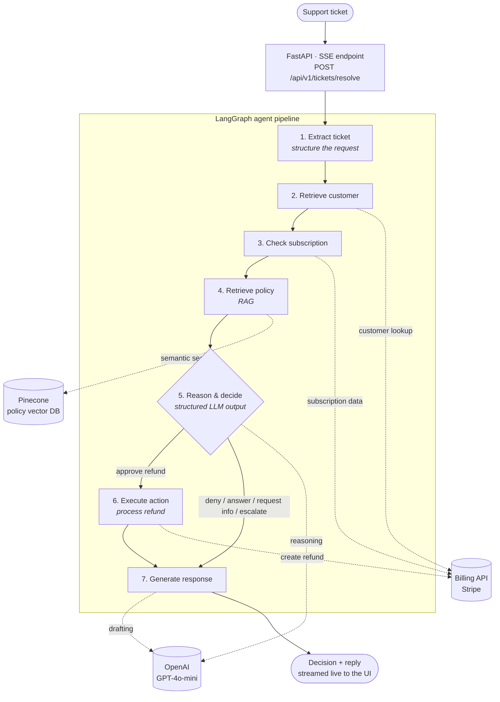
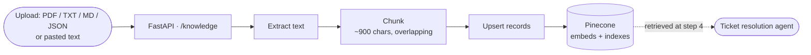

# Architecture — Autonomous Payment Support Agent

A visual and component-level overview of the system. The diagrams use
[Mermaid](https://mermaid.js.org/) and render natively on GitHub and in most
Markdown viewers.

---

## 1. Ticket resolution flow

This is the runtime path of a support ticket — from arrival to a streamed
decision and drafted reply. It is a **LangGraph** state machine: each node is a
small, independently testable step, and one **conditional edge** decides whether
an action is executed.

**The conditional edge.** After step 5, a router inspects the decision:
`approve_refund` routes through **Execute action**; every other outcome
(`deny_refund`, `answer_question`, `request_more_info`, `escalate_to_human`)
skips execution and goes straight to **Generate response**. The agent only
performs money-moving actions when explicitly approved.

---

## 2. Knowledge ingestion flow

How company policy documents enter the system so the agent can ground its
decisions in them. Embedding is performed server-side by Pinecone's integrated
inference — no separate embedding service is required.

---

## 3. Components

| Component | Responsibility |
|---|---|
| **FastAPI app** | HTTP surface; streams agent progress as Server-Sent Events |
| **LangGraph graph** | Orchestrates the 7 nodes and the conditional edge |
| **Agent nodes** | One file per step — extract, retrieve customer, check subscription, retrieve policy, reason & decide, execute action, generate response |
| **Mock Stripe tool** | Billing integration boundary (customer lookup, subscriptions, refunds) — swappable for the live Stripe API |
| **Knowledge base (RAG)** | Document ingestion, chunking, and Pinecone-backed semantic retrieval |
| **OpenAI client** | Shared async client for the two LLM steps |
| **Trace callback** | Logs every node start/finish for observability — no logging code inside nodes |

---

## 4. Technology stack

| Layer | Technology |
|---|---|
| API & streaming | FastAPI, Server-Sent Events |
| Orchestration | LangGraph |
| Reasoning | OpenAI GPT-4o-mini (structured outputs) |
| Retrieval | Pinecone (integrated-inference vector DB) |
| Billing integration | Stripe (mocked for development) |
| Validation | Pydantic v2 |

---

## 5. Design principles

1. **Grounding over fluency** — decisions are made from real billing data and
   retrieved policy, never from the model's prior knowledge.
2. **Conditional, scoped action** — money-moving steps run only on an explicit
   approved decision.
3. **Graceful failure** — any LLM or API failure degrades to
   `escalate_to_human`; the worst case is a delay, never a wrong action.
4. **Observable by default** — every step is traced and streamed, so the
   agent's reasoning is auditable end to end.
5. **Small, testable steps** — the system is a graph of verifiable nodes, not a
   single opaque prompt.
